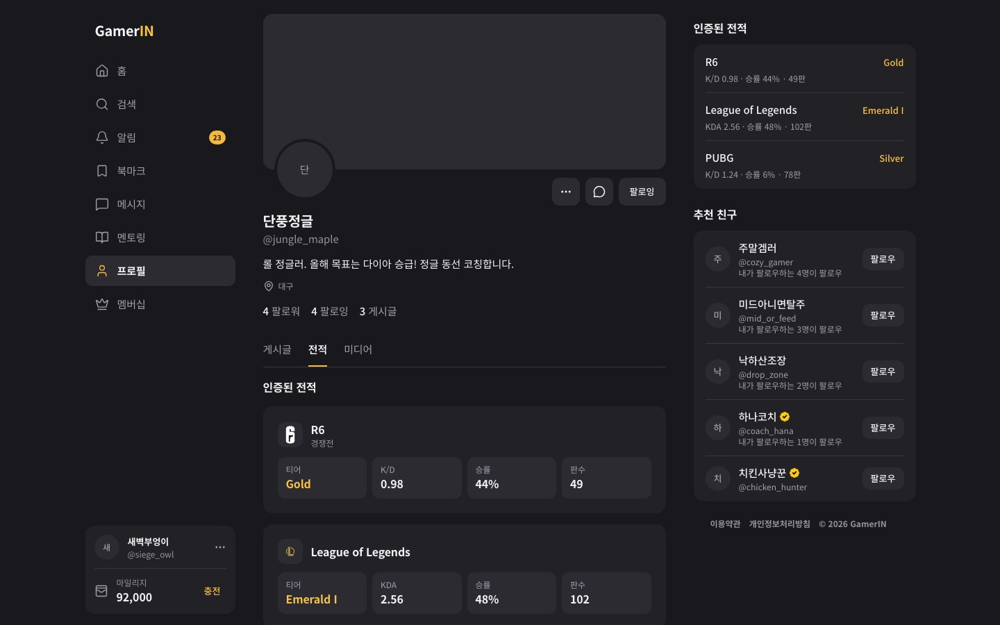
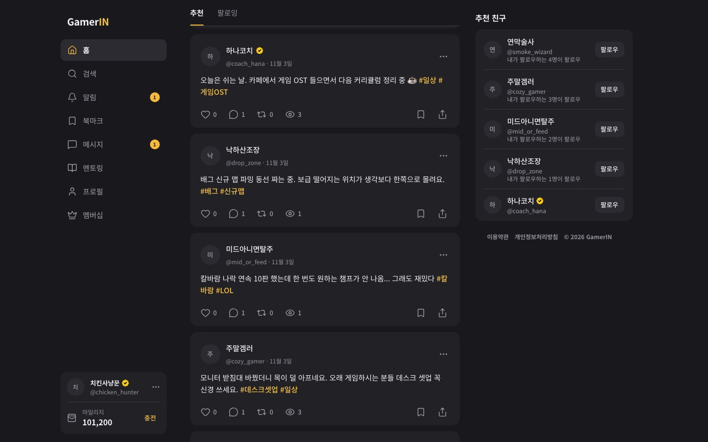
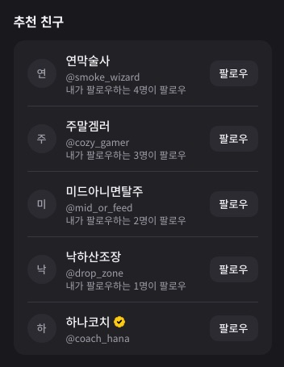
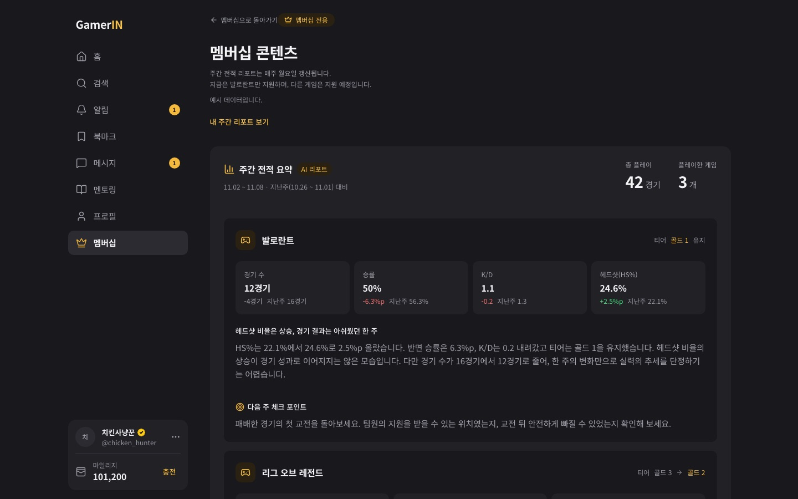
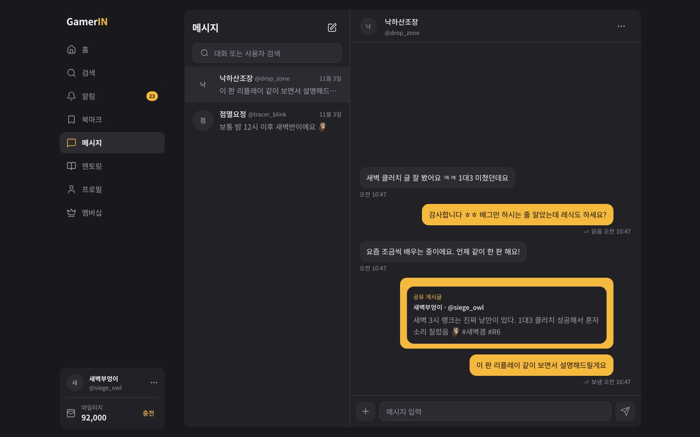
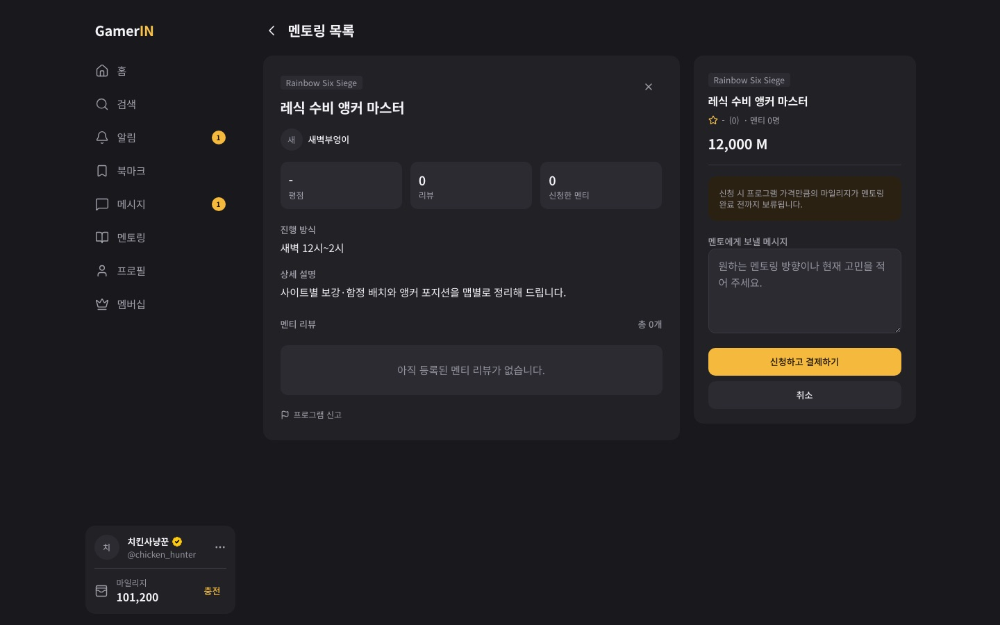
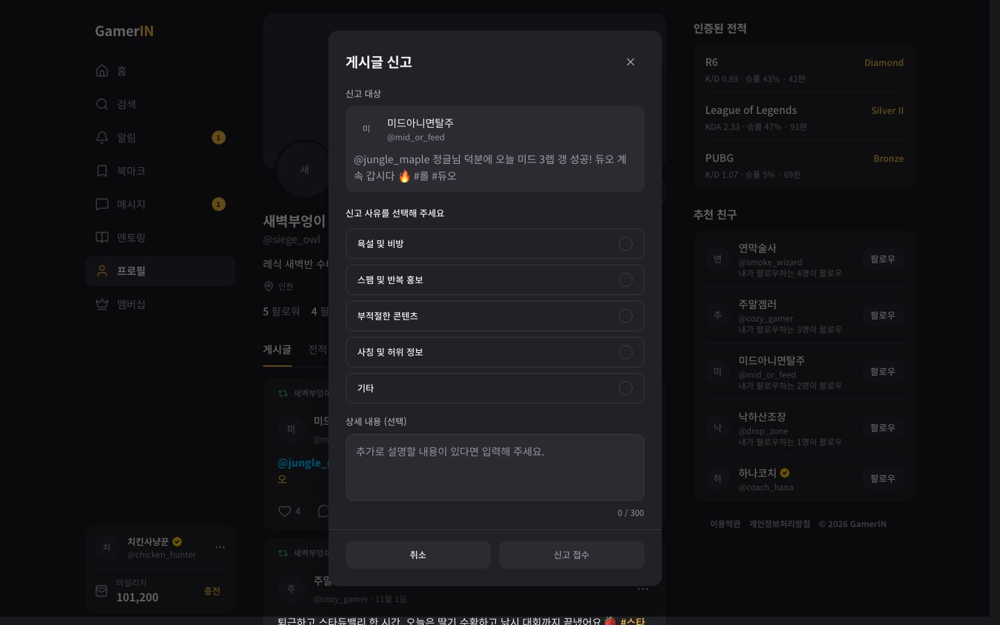
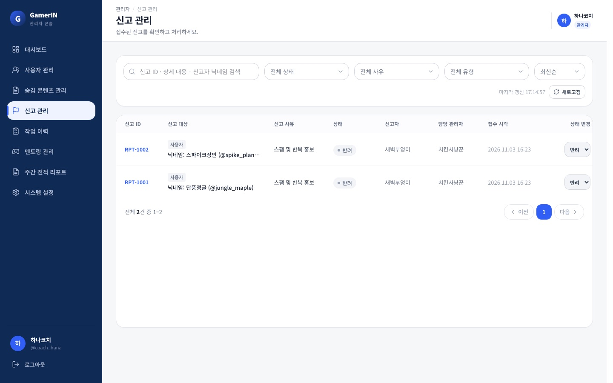
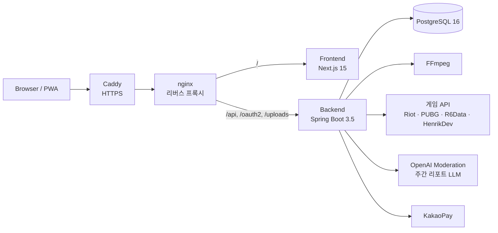
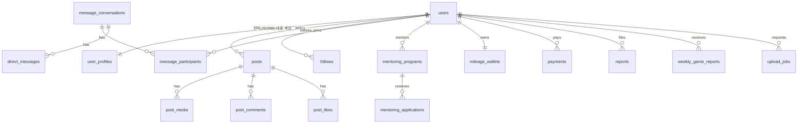

<p align="center">
  
</p>

<h1 align="center">GamerIN</h1>

<p align="center">
  검증된 게임 전적을 프로필로 삼는 게이머 커리어 SNS
</p>

<p align="center">
  
  
  
  
  
  
  
</p>

<p align="center">
  <b>🔗 <a href="https://gamerin.live">gamerin.live</a></b>
  &nbsp;·&nbsp; <a href="https://gamerin.live/demo">소개 페이지</a>
</p>

| 기간 | 인원 | 구분 | 배포 |
| --- | --- | --- | --- |
| 2026.03 ~ 2026.12 | 5명 | 청주대학교 캡스톤디자인 | Oracle Cloud 운영 중 |

## 시연 영상

[](https://youtu.be/X_XFwUejBXo)

## 소개

GamerIN은 **'게이머를 위한 LinkedIn'**을 목표로, 이스포츠 업계와 일반 게이머를 잇는 소셜·전적·멘토링 통합 플랫폼입니다.

X 같은 SNS는 사용자층이 넓고 확산이 빠르지만 게임 특화 기능이 없습니다. 그래서 전적은 전적 검색 사이트, 하이라이트는 SNS, 구인구직은 디스코드처럼 게이머의 활동이 여러 서비스로 흩어집니다. 티어는 바이오에 직접 적어야 해서 실력을 따로 증빙해야 하고, 개인 간 코칭 거래에는 수업료를 보호할 장치가 없습니다.

GamerIN은 피드와 DM에 게임 특화 기능을 더해 이 흐름을 한곳으로 모았습니다.

- **전적 연동**: LoL·발로란트 등 게임 API로 조회한 티어와 전적을 프로필에 표시해, 별도 증빙 없이 실력을 보여줍니다.
- **피드·DM**: 하이라이트 영상과 글을 공유하고, 게이머끼리 바로 대화합니다.
- **멘토링**: 상위 티어 유저가 멘토링 프로그램을 열고, 수업료는 수업이 끝날 때까지 플랫폼이 에스크로로 보관합니다.
- **AI 주간 리포트**: 지난주 발로란트 경쟁전을 분석해 LLM이 코칭 해설을 작성합니다.

신뢰할 수 있는 실력 이력을 바탕으로 게이머가 소통하고 성장하는 환경을 제공합니다.

## 주요 기능

| 기능 | 설명 | 화면 |
| --- | --- | --- |
| 게임 전적 연동 | PUBG, 레인보우 식스 시즈, 리그 오브 레전드, 발로란트 4종을 지원합니다. 대표 게임을 정하면 피드, 댓글, 프로필 어디서든 실제 티어 엠블럼이 표시됩니다. 하나의 게임 계정은 한 사용자만 연동할 수 있습니다. |  |
| 소셜 피드 | 이미지·영상 게시물, 좋아요, 댓글, 리포스트, 해시태그, `@` 멘션, 북마크 모음집, 통합 검색을 제공합니다. 비로그인 상태에서도 피드와 프로필을 볼 수 있습니다. |  |
| 추천 친구 | 내가 팔로우하는 사람들이 팔로우하는 사람(2촌)을 공통 연결 수 순으로 추천합니다. |  |
| AI 주간 전적 리포트 | 지난주 발로란트 경쟁전을 서버가 라운드 단위로 분석하고, LLM이 코칭 해설을 작성합니다. 멤버십 회원에게 매주 월요일 생성됩니다. |  |
| 실시간 DM·알림 | SSE 기반 1:1 메시지와 16종 알림을 제공합니다. DM 첨부 파일은 대화 참여자만 받을 수 있습니다. |  |
| 멘토링·결제 | 멘토 승인제, 카카오페이 단건 결제로 충전하는 마일리지, 에스크로 정산, 30일 멤버십을 지원합니다. |  |
| 콘텐츠 안전 | 업로드 파일의 시그니처를 검사하고, OpenAI Moderation으로 글·이미지·영상 프레임을 사전 검열합니다. 신고 5건이 쌓이면 자동으로 숨기고 단계별로 제재합니다. |  |
| 관리자 콘솔 | 신고 처리, 이용 제재, 멘토 승인, 멘토링 분쟁 시 강제 환불·정산, 감사 로그를 제공합니다. |  |

## 아키텍처



- 프론트엔드, 백엔드, 인프라를 저장소 3개로 나눠 각각 배포합니다.
- nginx가 경로별 업로드 용량과 요청 빈도를 제한하고, SSE 경로는 버퍼링을 끄고 타임아웃을 1시간으로 둡니다.
- 인증은 stateless JWT입니다. Access Token은 프론트 메모리에만 두고, Refresh Token은 HttpOnly 쿠키로 주고받습니다.

### ERD (주요 테이블)

전체 47개 테이블 중 핵심 흐름에 쓰이는 테이블만 추렸습니다. 관계는 단순화했습니다.



스키마는 Flyway 마이그레이션 52개로 관리합니다. 게임마다 형식이 다른 전적은 `user_profiles.game_stats` JSONB 컬럼 하나에 저장합니다.

### API

REST API는 `/api/v1/...` 아래 엔드포인트 160여 개로 구성했습니다. 성공 응답과 커서 목록은 아래 형식으로 통일했습니다.

```json
{ "success": true, "data": { "items": [], "nextCursor": "...", "hasNext": true } }
```

오류 응답은 `{ "success": false, "message": "..." }`입니다. 전체 명세는 백엔드 실행 후 Swagger UI(`/swagger-ui.html`)에서 확인할 수 있습니다.

### 배포

[gamerin.live](https://gamerin.live)에서 실제로 서비스하고 있습니다. 2026년 11월부터 Oracle Cloud 인스턴스 한 대에 Docker Compose로 운영하고 있습니다.

| 항목 | 내용 |
| --- | --- |
| 인스턴스 | OCI `VM.Standard.A1.Flex` (Ampere ARM64, 2 OCPU, 12 GB RAM), 도쿄 리전, Ubuntu 24.04 |
| 저장소 | 데이터 전용 블록 볼륨 150 GB (DB·업로드·인증서) |
| 컨테이너 | Caddy, nginx, Frontend, Backend, PostgreSQL 16 |
| HTTPS | Caddy가 Let's Encrypt 인증서를 자동 발급·갱신하고, 외부에는 80/443만 엽니다. |
| 배포 | `scripts/deploy.sh` 한 번으로 이미지 빌드, 서비스 기동, nginx 설정 검사와 reload까지 진행합니다. |

## 기술 스택

| 구분 | 내용 |
| --- | --- |
| Frontend | Next.js 15 (App Router), React 19, TypeScript, Tailwind CSS 4 |
| Backend | Java 21, Spring Boot 3.5, Spring Security, Spring Data JPA, OAuth2 Client, JWT, Flyway |
| DB | PostgreSQL 16 |
| Infra | Oracle Cloud, Docker Compose, Caddy, nginx, GitHub Actions |
| Test | JUnit 5, Mockito, Vitest, Playwright |
| 외부 연동 | Google OAuth2, Riot, PUBG, R6Data, HenrikDev, OpenAI, KakaoPay |

테스트는 백엔드 173개 파일(PostgreSQL 16 동시성 통합 테스트 포함), 프론트엔드 Vitest 115개 파일, Playwright E2E 22개 스펙입니다.

## 트러블슈팅

### 1. 영상 업로드 504 타임아웃과 게시물 중복 생성

**문제.** 영상 게시물을 올리면 하나의 HTTP 요청 안에서 OpenAI 검열과 FFmpeg 재인코딩을 모두 처리했습니다. 긴 영상은 60초를 넘겨 nginx가 504를 반환했습니다. 처리하는 동안 DB 커넥션도 붙잡고 있었습니다. 사용자가 재시도하면 같은 게시물이 두 번 저장됐습니다.

**해결.**

- 업로드를 접수와 처리로 나눴습니다. 요청에서는 파일 시그니처와 용량만 검증하고 임시 경로에 저장한 뒤 `202 Accepted`와 작업 ID를 바로 반환합니다.
- 작업은 `upload_jobs` 테이블에 쌓고, 단일 워커가 `SELECT ... FOR UPDATE SKIP LOCKED`로 하나씩 가져갑니다. 검열과 인코딩은 DB 트랜잭션 밖에서 실행합니다.
- 클라이언트가 보내는 UUID와 파일 SHA-256 값을 함께 비교해 멱등성을 보장합니다. 같은 요청이 다시 오면 새 작업을 만들지 않고 기존 작업을 반환합니다.

**결과.** 처리 시간이 길어도 요청 스레드와 DB 커넥션을 점유하지 않고, 재전송해도 게시물이 중복 생성되지 않습니다.

### 2. 다중 탭에서 Refresh Token Rotation이 탈취로 오판됨

**문제.** Refresh Token은 사용할 때마다 새로 발급하고(rotation), 이미 쓴 토큰이 다시 들어오면 탈취로 보고 해당 사용자의 모든 세션을 폐기했습니다. 그런데 탭 여러 개가 동시에 `/auth/refresh`를 호출하면, 첫 요청이 토큰을 회전시킨 직후 두 번째 요청이 재사용으로 판정돼 정상 사용자가 로그아웃됐습니다.

**해결.**

- 토큰은 SHA-256 해시로 저장하고, 갱신할 때 해당 행에 비관적 락(`SELECT ... FOR UPDATE`)을 겁니다. 회전한 시각은 `rotated_at`에 기록합니다.
- 회전 후 30초 안에 같은 토큰이 오면 동시 갱신으로 보고 `409 Conflict`를 반환합니다. 이때 쿠키는 지우지 않으며, 프론트가 최대 3번 재시도해 새 토큰을 받습니다.
- 30초가 지난 뒤의 재사용만 탈취로 판단해 모든 토큰을 폐기합니다.

**결과.** 토큰 재사용 탐지는 유지하면서 다중 탭 환경에서도 로그인이 끊기지 않습니다.

### 3. LLM이 주간 전적 증감 방향을 반대로 서술함

**문제.** 주간 요약 통계만 LLM에 넘기자, 지난주 대비 증감 방향을 반대로 쓰는 오류가 6번 중 5번 나왔습니다. 두 주의 판수가 다르면 비율과 합계를 혼동했고, 근거 없이 요원 변경을 권하기도 했습니다.

**해결.**

- 판단에 필요한 계산은 모두 서버에서 결정적으로 처리하고, LLM은 해설만 쓰도록 역할을 나눴습니다.
- 서버가 경기 원본 데이터에서 라운드·킬 이벤트를 파싱해 9가지 근거를 산출합니다. 첫 교전, 공수 진영별 성적, 스파이크 설치 이후 성적, 5초 내 킬 교환, ±1000 크레딧 장비 격차 등이 여기에 해당합니다.
- 17개 지표의 전주 대비 증감 방향도 서버가 판정해 프롬프트에 넣습니다.
- 닉네임, PUUID, 경기 ID는 요청 본문에서 제외했습니다.
- 14종 모델로 113회 호출하는 비교 실험을 거쳐 기본 모델과 프롬프트를 정했습니다. AI 호출이 실패하면 규칙 기반 문장으로 대체합니다.

**결과.** 최종 검증 6회에서 사실 오류 0건을 기록했습니다.

### 4. 닉네임 기반 전적 연동의 사칭과 경합

**문제.** Riot RSO 같은 게임사 공식 OAuth는 프로덕션 키 심사나 제휴가 있어야 사용할 수 있습니다. 학생 프로젝트에서는 이를 받을 수 없어 닉네임·Riot ID 입력 방식으로 전환했고, 그 결과 세 가지 위험이 생겼습니다.

- 남의 닉네임을 먼저 등록하는 사칭
- 연동을 해제하거나 다시 연결하는 사이에 늦게 도착한 외부 API 응답이 최신 상태를 덮어쓰는 경합
- 타인에게 `accountId`·`puuid` 같은 외부 식별자가 노출되는 문제

**해결.**

- `WHERE connected = true` 조건의 부분 UNIQUE 인덱스로 하나의 게임 계정을 여러 사용자가 연동하지 못하게 막았습니다. 중복 연동 시 `409`를 반환합니다.
- 외부 API 호출은 트랜잭션 밖(`Propagation.NOT_SUPPORTED`)에서 실행합니다. 저장할 때만 행 잠금을 걸고 연결 버전을 비교해, 최신 요청의 결과만 반영합니다.
- 타인 프로필 응답은 화이트리스트에 있는 필드만 내보냅니다.

### 5. 프록시·첨부 파일·결제 경로의 정보 노출

**문제.** 세 군데에서 정보가 새거나 제한을 우회할 수 있었습니다.

- 클라이언트가 조작할 수 있는 `X-Forwarded-For`로 Rate Limit을 우회할 수 있었습니다.
- DM 첨부 파일을 공개 `/uploads` 경로로 직접 열 수 있었습니다.
- 카카오페이 `pg_token`이 프록시 로그와 Referer에 남았습니다.

**해결.**

- nginx는 Caddy의 고정 IP에서 온 전달 헤더만 신뢰합니다(`set_real_ip_from`).
- DM 첨부의 정적 경로는 필터로 차단하고, 대화 참여 여부를 확인하는 인증 다운로드 API로만 내려줍니다.
- Caddy와 nginx 양쪽 로그에서 `pg_token`을 지우고, 결제 결과 페이지는 `no-referrer`로 응답합니다.

## 팀원과 역할

| 팀원 | 담당 파트 |
| --- | --- |
| 서장호 | 풀스택·인프라: 인증 보안, 결제, 미디어 파이프라인, 발로란트·AI 리포트, 디자인 시스템 v2, 배포 |
| 전준범 (팀장) | 프론트엔드: 신고·관리자 백오피스, LoL 연동 화면, 품질 개선 |
| 김신의 | 프론트엔드: 피드·DM·북마크·검색·알림 화면, 공용 훅 |
| 방경식 | 백엔드: 커뮤니티·DM·알림 코어, R6·PUBG 전적과 동시성, 멤버십 |
| 이상혁 | 백엔드: 초기 인증 구조, 멘토링·정산, 신고·관리자 |

### 전준범 · 팀장, 프론트엔드 ([@jeonjunbum](https://github.com/jeonjunbum))

팀장으로 프로젝트를 이끌면서 신고·관리자 백오피스를 중심으로 프론트엔드를 개발했습니다.

- **신고·관리자 백오피스**: 게시물·댓글·사용자 신고 UI와 내 신고 내역을 만들었습니다. 관리자 대시보드, 콘텐츠·멘토링·신고·사용자·감사 로그·설정 화면과 접근 제어(RouteGuard)도 구현했습니다. 목업으로 시작한 화면(43개 파일)을 실제 API에 연결하면서 Playwright E2E와 단위 테스트도 함께 작성했습니다.
- **멘토링·결제 화면**: 멘토링 화면의 첫 버전을 만들었고, 카카오페이 지갑과 멤버십 UI를 서비스에 통합했습니다.
- **LoL 연동**: Riot API 기반 리그 오브 레전드 계정 연결·전적 조회 화면을 만들고, 전용 E2E 테스트를 작성했습니다.
- **품질 개선**: 홈 피드 무한 스크롤, 화면 문구 한국어화와 상대 시간 표기 통일, 다크 모드와 게시글 상호작용 개선을 맡았습니다. 북마크 모음집 개수 동기화, OAuth 완료 화면 등 여러 기능이 맞물리는 지점의 결함도 해결했습니다.
- **빌드**: 프론트 Dockerfile에서 `next.config` 변환과 런타임 환경변수 전달을 보완했습니다.

### 김신의 · 프론트엔드 ([@Kimsinui531](https://github.com/Kimsinui531))

초기 프론트엔드 프로토타입부터 시작해 커뮤니티 화면의 상당 부분을 맡았습니다.

- **피드·프로필**: 초기 프로필·게시글 화면 구조, 피드 작성·수정·삭제, 썸네일 UI, 게시물 공유 모달을 구현했습니다. 프로필의 "나를 팔로우합니다" 표시, 기본 커버 교체, 공개 프로필·설정 정비, 다크 모드 초기 작업, PUBG 닉네임 검증도 맡았습니다.
- **커뮤니티 API 연동**: 방경식이 만든 백엔드 API를 화면에 연결했습니다. DM 목록과 상호작용, 이전 메시지 페이지네이션, 북마크 모음집, 리포스트, 해시태그·통합 검색, 알림 목록과 읽음 상태가 여기에 해당합니다.
- **공용 로직 리팩터링**: 낙관적 좋아요 처리를 공용 훅 `usePostLike`로 추출했습니다. 커서 기반 게시글 목록 상태와 인증 오류 처리도 한곳으로 모아 화면별 중복 코드를 줄였습니다.

### 서장호 · 풀스택, 인프라 ([@wishufeeldasame](https://github.com/wishufeeldasame))

기획·테스트 담당으로 시작했지만, 개발을 진행하면서 프론트엔드, 백엔드, 인프라 전반을 맡았습니다. 저장소 3개의 커밋 711개 중 434개, 병합된 PR 268개 중 176개를 작성했고, Docker 저장소는 처음부터 직접 구축했습니다.

- **인증·보안**: 일반·소셜 로그인 플로우와 계정 복구, 이메일 인증번호, 약관·만 14세 동의, 탈퇴를 구현했습니다. 프론트 인증 요청은 공용 `api-client`로 통합하고, 비로그인 공개 탐색 구조를 만들었습니다. Refresh Token 경합 처리(트러블슈팅 2)와 Rate Limit 우회 차단(트러블슈팅 5)도 맡았습니다.
- **결제**: 카카오페이 단건 결제의 준비·승인·취소와 지연 주문 복구를 구현했습니다. 이용권 결제를 멤버십 부여·회수와 연결하고, 프록시 로그에서 `pg_token`을 지웠습니다.
- **미디어·DM 보강**: OpenAI 프레임 검열 병렬화, FFmpeg 등급별 H.264 재인코딩, 업로드 접수·처리 분리를 구현했습니다(트러블슈팅 1). DM은 `clientMessageId` 멱등 처리, SSE 일회용 스트림 토큰과 연결 수 제한, 안 읽은 메시지 수 분리를 보강했습니다.
- **게임·AI·추천**: HenrikDev 발로란트 연동, 대표 게임 티어, AI 주간 전적 리포트(트러블슈팅 3), 2촌 추천 친구, 게시글 숫자 URL과 조회수 집계를 구현했습니다.
- **디자인 시스템 v2**: 라이트·다크 토큰, 반응형 레이아웃과 모바일 하단 탭을 정의하고 주요 화면을 개편했습니다. 전시용 `/demo` 페이지와 PWA 설치도 만들었습니다.
- **인프라·운영**: Docker Compose, nginx, Caddy HTTPS, 프론트·백엔드 Dockerfile, GitHub Actions CI와 Discord 알림, 영상 인코딩 벤치마크, OCI 블록 스토리지 스크립트를 구축했습니다. OCI 서버 배포도 직접 했습니다.
- **통합·안정화**: 팀원이 만든 기능에서 생긴 결함을 많이 수정했습니다(제 커밋 중 154개가 버그 수정). DM 첨부 경계, 북마크 모음집 동기화, 신고 콘텐츠 14일 보존, 제재 집계 정합성 등이 여기에 해당합니다. 저장소별 작업 지침, PR 리뷰 절차, AI 코딩 에이전트 사용 규칙도 정리했습니다.

### 방경식 · 백엔드 ([@WhiteB1ossom](https://github.com/WhiteB1ossom))

커뮤니티, DM, 알림의 백엔드 코어를 만들었습니다. 백엔드 `src/main` 파일을 팀에서 가장 많이 작성했습니다.

- **커뮤니티 코어**: 게시글·댓글·팔로우 스키마를 처음 설계했습니다. 역방향 팔로우, 북마크와 북마크 모음집, 리포스트 타임라인, 해시태그·통합 검색, 멘션과 알림 시스템을 구현했습니다.
- **DM**: 대화방, 참여자, 메시지, 대화 삭제 이력을 다루는 1:1 메시지 API를 구현했습니다. 알림 읽음 처리와 새 DM 갱신이 충돌하는 동시성 문제도 해결했습니다.
- **게임 전적과 정합성**: R6Data 기반 레인보우 식스 시즈 연동을 만들고, PUBG와 R6 응답 형식을 공통화했습니다. 연결 버전으로 전적 동시 저장 유실을 막았고, 부분 UNIQUE 인덱스로 중복 연동을 막았습니다(트러블슈팅 4). 계정 교체 시 이전 전적 캐시 제거, 잘못된 PUUID 저장 차단도 맡았습니다.
- **멤버십 코어**: 멤버십 이용 기간 저장, 유효성 판정, 이용권 부여·회수, 멤버십 배지 API를 구현했습니다. 카카오페이 결제와 멤버십 게시물 수정은 이 코어 위에 만들어졌습니다.
- **운영 안정화**: 전역 예외 처리와 영상 업로드의 운영 리스크를 정비했습니다.

### 이상혁 · 백엔드 ([@lsh050121](https://github.com/lsh050121))

초기 인증 구조와 멘토링·정산·신고·관리자 백엔드를 맡았고, 마지막 기능은 프론트엔드와 nginx 설정까지 직접 연결했습니다.

- **초기 인증 구조**: UUID 기반 초기 스키마와 OAuth2 소셜 로그인 구조를 잡았습니다. 같은 이메일로 일반 가입한 계정을 Google 로그인과 자동 연동하는 기능, 인증 API Rate Limit과 로그인 실패 시 계정 잠금도 구현했습니다.
- **멘토링·마일리지 정산**: 멘토링 프로그램, 마일리지 지갑, 에스크로 정산 시스템을 구현했습니다. 음수 가격·마일리지 차감 취약점 수정, 오류 상태 코드 정규화, 에스크로 신청이 있는 프로그램의 소프트 삭제 보호를 맡았습니다. 수수료 공통화와 신청 시점 수수료율 스냅샷, 멤버십 게시물 수정도 구현했습니다.
- **신고·관리자**: 통합 신고 접수, 관리자 제재, 숨김 콘텐츠 복구 API를 만들었습니다. 정지·탈퇴 사용자의 JWT·SSE 접근은 즉시 차단했습니다. 멘토링 분쟁 신고가 들어오면 7일 자동 정산을 보류하고 에스크로 환불·정산과 연결했습니다.
- **풀스택 마무리**: 멘토링 프로그램 숫자 번호와 설명 이미지 업로드를 백엔드, 프론트엔드 상세 페이지, nginx 업로드 제한까지 저장소 3개에 걸쳐 함께 구현했습니다. 프로필 전적 화면의 게임 로고 아이콘 7종도 만들었습니다.

## 저장소

| 저장소 | 내용 |
| --- | --- |
| [gamerin_frontend](https://github.com/wishufeeldasame/gamerin_frontend) | 웹 클라이언트 |
| [gamerin_backend](https://github.com/wishufeeldasame/gamerin_backend) | API 서버 |
| [gamerin_docker](https://github.com/wishufeeldasame/gamerin_docker) | 배포·프록시 구성 |

## 한계와 향후 과제

- **단일 서버 전제**: Rate Limit 카운터, SSE 연결, 스트림 토큰이 JVM 메모리에 있고, 파일은 로컬 디스크에 있습니다. 수평 확장을 하려면 Redis와 오브젝트 스토리지로 옮겨야 합니다.
- **게임 계정 소유권**: 지금은 먼저 등록한 사람이 계정을 차지합니다. Riot RSO나 Steam OpenID 같은 공식 인증이 필요합니다.
- **AI 리포트 범위**: 발로란트만 지원합니다. 다른 게임으로 넓히고, 판정 임계값을 실사용 데이터로 보정해야 합니다.
- **운영 백업**: 백업·복원 스크립트는 있지만 아직 주기적으로 실행하지 않습니다. 데이터 볼륨에 백업을 쌓는 스케줄 작업이 필요합니다.
- **검색**: `LIKE` 기반이라 데이터가 늘면 `pg_trgm` 인덱스나 검색 엔진이 필요합니다.
